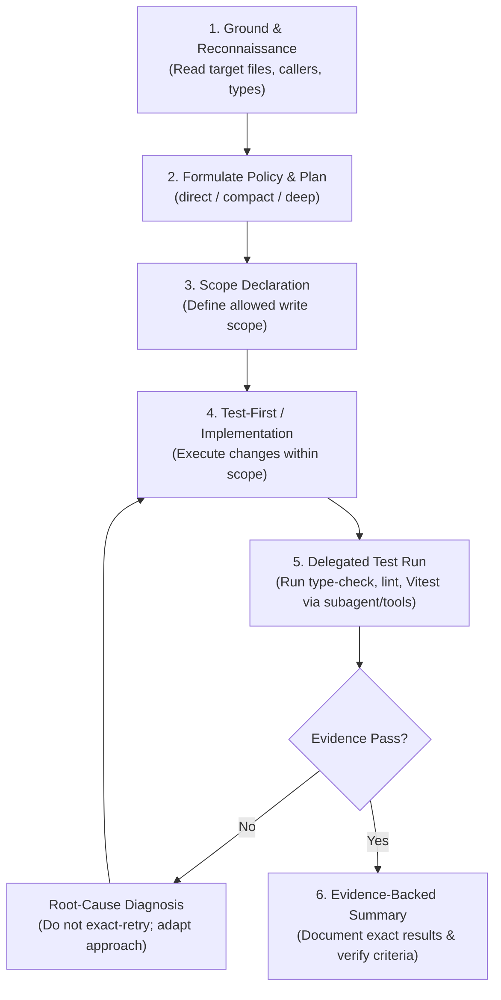

# AI_BRAIN.md — Architecture, Active Skills & Execution Flow

## 1. Project Domain: Dr. Baldawa's Dwarka Clinic (Jaysingpur)

### System Purpose
A high-throughput, offline-resilient Patient Intake & Receptionist Management Progressive Web Application (PWA) tailored for Dr. Baldawa's Dwarka Clinic in Jaysingpur.

### Operational Context & Clinical Requirements
- **High-Speed Receptionist Desk Workflow:** Fast patient registration, repeat patient search, token generation, visit triage, fee collection, and doctor queue management.
- **Offline-First Resilience:** Clinic connectivity in semi-urban environments can fluctuate. The PWA must support full local intake, queue management, and receipt printing even when completely disconnected from the internet.
- **Local Data Persistence:** Immediate persistence to browser IndexedDB with queued synchronization when online connectivity is restored.
- **Data Integrity & Zero Loss:** No intake record or billing entry can be lost due to network dropouts, page refreshes, or accidental tab closures.
- **Bilingual / Localized Usability:** Interface optimized for fast keyboard navigation and Marathi/Hindi/English phonetic search and label clarity.

---

## 2. Technical Stack Architecture

| Layer | Technology | Rationale |
| :--- | :--- | :--- |
| **Runtime & Build** | Vite + React (TypeScript) | Lightning-fast HMR, lean bundle, strict type safety |
| **Application Type** | Progressive Web App (`vite-plugin-pwa`) | Service worker caching, installable on reception tablet/desktop, background sync |
| **Local Persistence** | IndexedDB via `Dexie.js` or `idb` | Indexed queries for patient phone/name, ACID transactions, offline persistence |
| **State Management** | Zustand or React Context + Hook Stores | Predictable state updates, zero unnecessary re-renders during high-volume typing |
| **UI & Styling** | Tailwind CSS + Lucide Icons | Accessible, high-contrast, compact reception desk layout with zero bundle runtime bloat |
| **Validation** | Zod | Runtime schema validation for phone numbers, age, gender, medical complaints |
| **Testing** | Vitest + React Testing Library | Fast unit and component tests with mock storage and offline simulation |

---

## 3. Active Skills Registry

The following curated, project-tailored skills are permanently activated under `.agents/skills/`:

1. **`gravitas-reliability`** (`.agents/skills/gravitas-reliability/SKILL.md`)
   - *Role:* Grounding, scoped reconnaissance, invariant enforcement, decision recording, and zero-hallucination verification.
2. **`systematic-debugging`** (`.agents/skills/systematic-debugging/SKILL.md`)
   - *Role:* Iron Law root-cause investigation, 4-phase error tracing, hypothesis validation, and non-destructive isolation.
3. **`pwa-offline-indexeddb`** (`.agents/skills/pwa-offline-indexeddb/SKILL.md`)
   - *Role:* Service worker lifecycle, IndexedDB schema design, offline write queues, conflict resolution, and storage quotas.
4. **`vitest-tdd-workflow`** (`.agents/skills/vitest-tdd-workflow/SKILL.md`)
   - *Role:* Vite-native test generation, component interaction tests, test-first bug fixing, and mock IndexedDB harnesses.
5. **`typescript-expert`** (`.agents/skills/typescript-expert/SKILL.md`)
   - *Role:* Strict domain modeling (Patient, Appointment, Visit, Invoice, QueueStatus), generic utilities, and exhaustive checks.
6. **`react-best-practices`** (`.agents/skills/react-best-practices/SKILL.md`)
   - *Role:* Container/presentational separation, optimized render loops, form state management without keystroke lag.
7. **`healthcare-security-privacy`** (`.agents/skills/healthcare-security-privacy/SKILL.md`)
   - *Role:* Patient data privacy standards, PII isolation, secure local exports, audit logs, and input sanitization.

---

## 4. Standard Agent Execution Flow

Every non-trivial engineering task follows the standard Gravitas + ECC execution loop:



### Action Checkpoint Template
For multi-file changes or state updates, emit this checkpoint before executing:
```markdown
### Execution Plan Checkpoint
- **Action Target:** [Files to create or edit]
- **Reason:** [Direct requirement link]
- **Grounding Evidence:** [Lines/symbols read]
- **Risk Assessment:** [Low / Med / High]
- **Verification Validator:** [Type check / Unit test / Build check]
```
