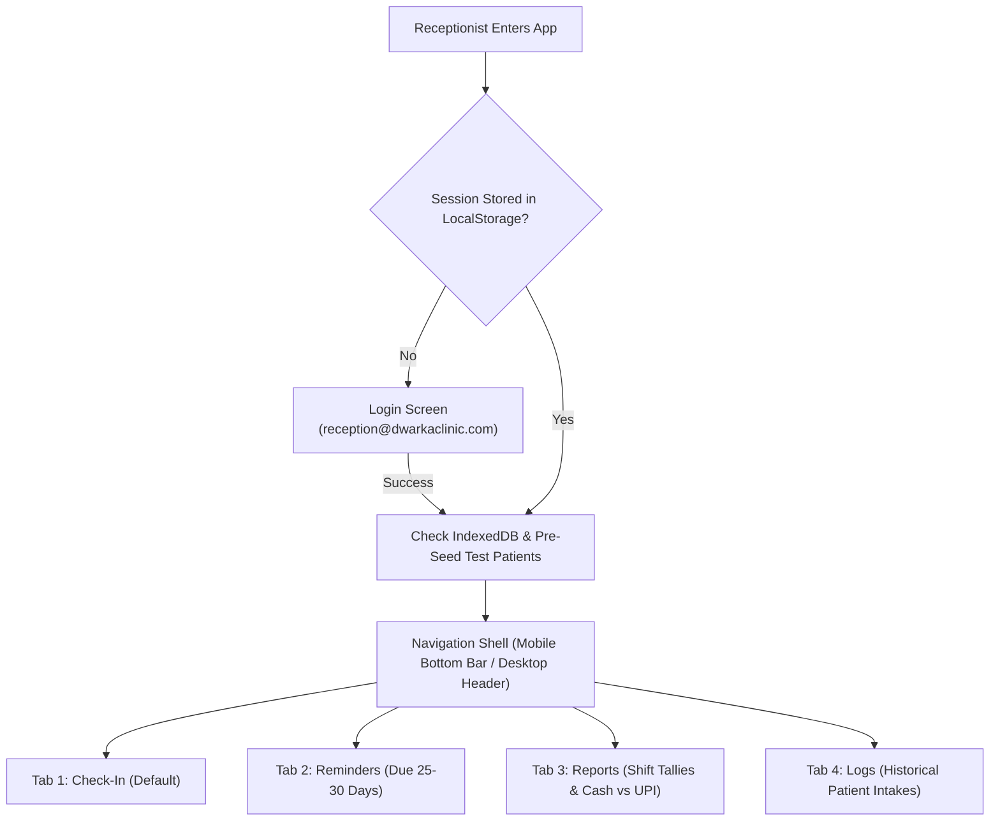
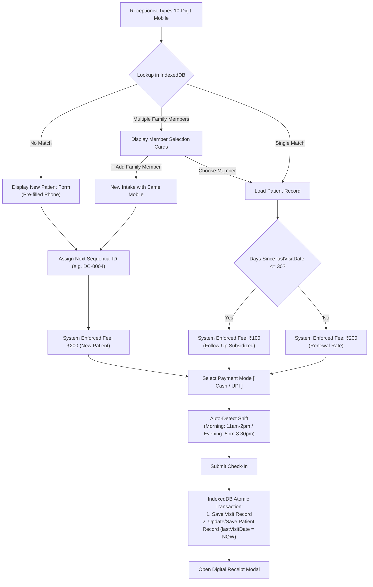
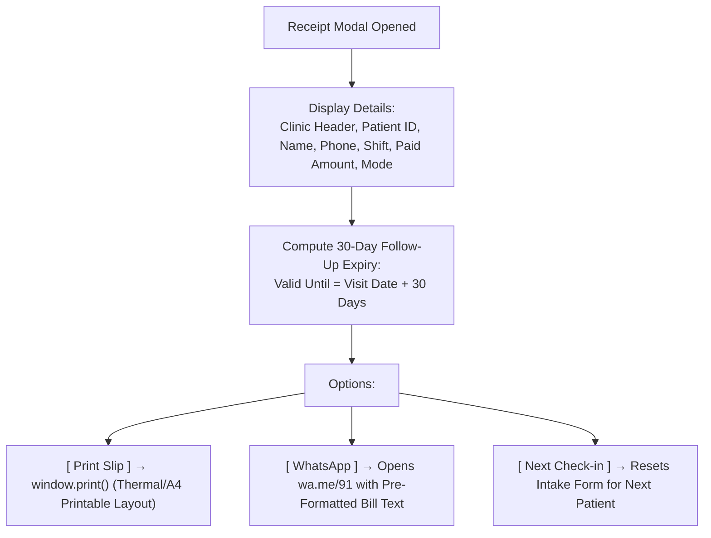
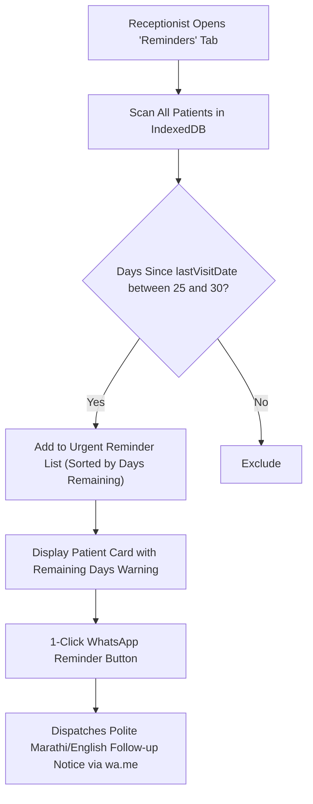
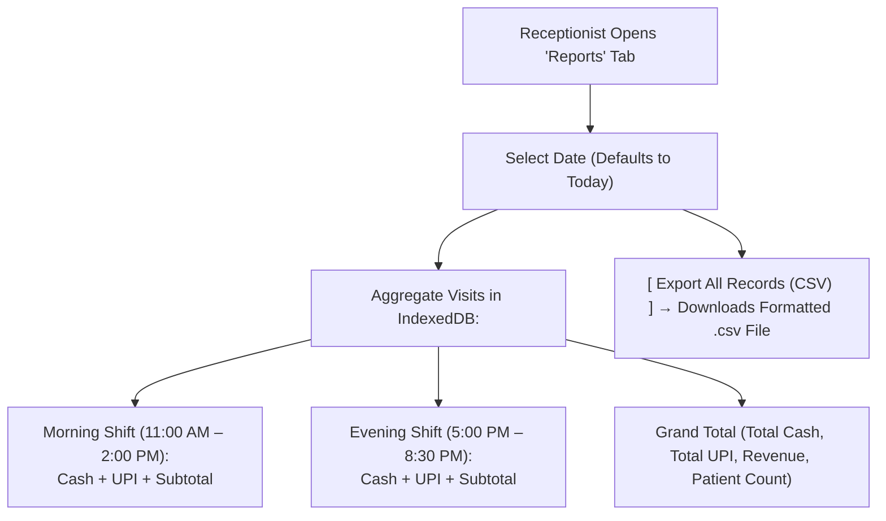
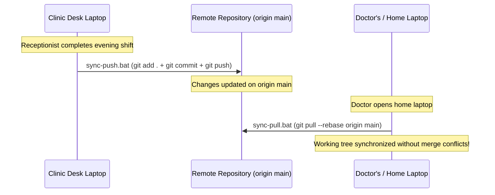

# FLOW.md — Operational & Clinical Workflows

> Dr. Baldawa's Dwarka Clinic (Jaysingpur) — Milestone 1 Intake & Financial Operations

---

## 1. System Navigation & Architecture Flow

---

## 2. Check-In & Fee Automation Workflow

---

## 3. Receipt & WhatsApp Dispatch Workflow

---

## 4. 30-Day Subsidized Follow-Up Reminders Workflow

---

## 5. Shift Tallies & Financial Reports Workflow

---

## 6. Multi-Laptop Git Synchronization Flow

